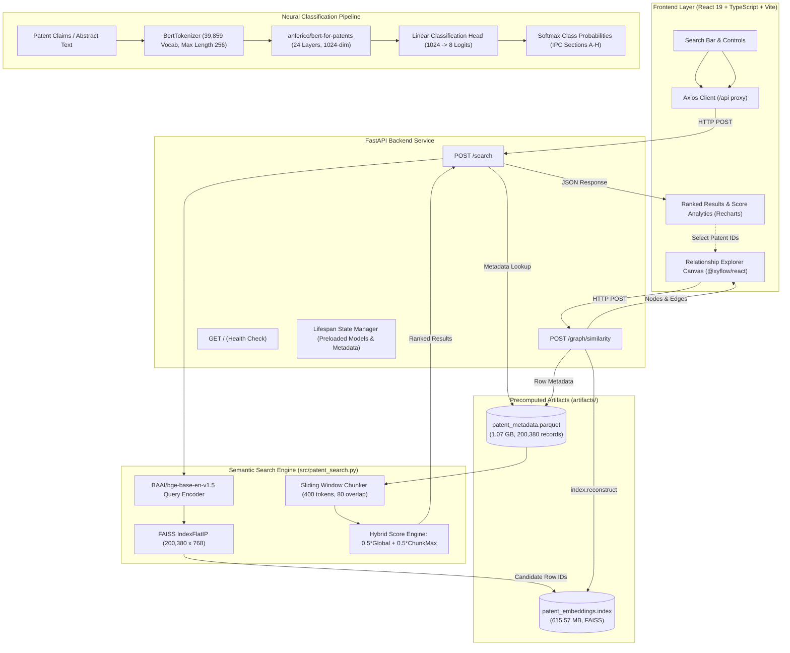

# PatentBERT: Semantic Search, Neural Classification & Relationship Explorer

[](https://www.python.org/)
[](https://fastapi.tiangolo.com/)
[](https://react.dev/)
[](https://www.typescriptlang.org/)
[](https://vitejs.dev/)
[](https://github.com/facebookresearch/faiss)
[](https://pytorch.org/)

An end-to-end patent intelligence platform designed to overcome the vocabulary mismatch problem in prior-art discovery, classify patent disclosures into International Patent Classification (IPC) sections using fine-tuned BERT models, and interactively explore high-dimensional vector similarity networks.

---

## Table of Contents

- [1. Project Overview & Capabilities](#1-project-overview--capabilities)
- [2. System Architecture](#2-system-architecture)
  - [A. Semantic Search & Chunk Reranking Engine](#a-semantic-search--chunk-reranking-engine)
  - [B. Neural IPC Classification Pipeline](#b-neural-ipc-classification-pipeline)
  - [C. Patent Relationship Graph Engine](#c-patent-relationship-graph-engine)
- [3. Dataset & IPC Taxonomy](#3-dataset--ipc-taxonomy)
- [4. Tokenization & Input Representation](#4-tokenization--input-representation)
- [5. Fine-Tuned PatentBERT Classifier](#5-fine-tuned-patentbert-classifier)
- [6. Benchmark Evaluation & Results](#6-benchmark-evaluation--results)
- [7. Semantic Search Engine & FAISS Vector Index](#7-semantic-search-engine--faiss-vector-index)
- [8. Patent Relationship Explorer](#8-patent-relationship-explorer)
- [9. Backend API Service](#9-backend-api-service)
- [10. Frontend Intelligence Dashboard](#10-frontend-intelligence-dashboard)
- [11. Repository Structure](#11-repository-structure)
- [12. Local Setup & Execution Guide](#12-local-setup--execution-guide)

---

## 1. Project Overview & Capabilities

Patent disclosures are dense, legalistic documents written using broad, abstract synonyms to maximize legal claim protection. Traditional keyword-based retrieval systems (such as BM25 or boolean queries) frequently fail because identical technological concepts are expressed with entirely distinct vocabularies (e.g., *"wearable acoustic sensor"* vs. *"phonocardiogram stethoscope"*).

**PatentBERT** delivers a unified patent intelligence system with three core capabilities:

1. **Semantic Patent Search:** Dense vector retrieval across **200,380 patents** using `BAAI/bge-base-en-v1.5` embeddings (768 dimensions) and an exact inner-product FAISS index (`IndexFlatIP`), paired with a sliding-window chunk reranker ($\alpha = 0.5$) that surfaces exact matching claims.
2. **Multi-Class Patent Classification:** A domain-specific neural classifier fine-tuned from `anferico/bert-for-patents` (24 layers, 1024 hidden dimension, 344M parameters) that classifies patent text into the 8 primary International Patent Classification (IPC) Sections (**A** through **H**), achieving **78.67% test accuracy** and **78.64% macro F1-score** across 20,038 test patents.
3. **Patent Relationship Explorer:** An interactive vector network visualization tool powered by `@xyflow/react` that reconstructs 768-dimensional latent vectors directly from FAISS, calculates pairwise cosine similarity matrices, and dynamically renders inter-patent connection graphs based on configurable similarity thresholds.

---

## 2. System Architecture



### A. Semantic Search & Chunk Reranking Engine
1. **Query Encoding:** User queries are encoded into 768-dimensional L2-normalized embeddings via `BAAI/bge-base-en-v1.5`.
2. **First-Stage Retrieval:** FAISS `IndexFlatIP` performs exhaustive inner-product search across 200,380 pre-indexed patent embeddings to find candidate matches.
3. **Sliding-Window Chunking:** Candidate documents are segmented into 400-token chunks with 80-token overlap.
4. **Hybrid Scoring:** Documents are reranked using a balanced fusion metric:
   $$\text{hybrid\_score} = 0.5 \cdot \text{global\_similarity} + 0.5 \cdot \max_{c \in \text{chunks}}(\text{chunk\_similarity}_c)$$
5. **Enriched Delivery:** Returns sorted results with IPC section, class, subclass, and the exact matching text passage.

### B. Neural IPC Classification Pipeline
1. Ingests full patent disclosures (abstracts or claims).
2. Tokenizes text using a domain-specific WordPiece vocabulary of 39,859 subwords.
3. Extracts contextual representations through a 24-layer transformer backbone.
4. Projects the pooled `[CLS]` state ($1024 \to 8$) to predict normalized class probabilities across IPC Sections A–H.

### C. Patent Relationship Graph Engine
1. Takes 2 to 25 patent IDs selected from search results.
2. Reconstructs original 768-dimensional vector representations directly from the FAISS index in $O(1)$ time.
3. Computes the full $(N \times N)$ pairwise cosine similarity matrix.
4. Filters connections using an adjustable similarity threshold (default `0.65`) and returns a structured node-and-edge graph for visualization.

---

## 3. Dataset & IPC Taxonomy

The system is built on the large-scale USPTO patent benchmark dataset ([`ufukham/uspto_balanced_200k_ipc_classification`](https://huggingface.co/datasets/ufukham/uspto_balanced_200k_ipc_classification)):

* **Total Dataset Size:** **200,380 patents**.
* **Classification Target:** Single-label classification across the 8 primary International Patent Classification (IPC) sections.
* **Corpus Partitioning:**
  - **Training Split:** 171,324 patents (85.5%)
  - **Validation Split:** 9,018 patents (4.5%, stratified 5% split of the training pool)
  - **Test Split:** 20,038 patents (10.0%, held-out for final benchmarking)

### Target IPC Section Distribution

| Label | IPC Section | Domain Definition & Typical Technologies | Total Patents | Test Support |
|:---:|:---:|:---|:---:|:---:|
| `0` | **A** | **Human Necessities:** Agriculture, food, apparel, medicine, dentistry | 25,050 | 2,486 |
| `1` | **B** | **Performing Operations; Transporting:** Machining, printing, vehicles, robotics | 25,050 | 2,520 |
| `2` | **C** | **Chemistry; Metallurgy:** Chemical synthesis, metallurgy, biotechnology, materials | 25,050 | 2,469 |
| `3` | **D** | **Textiles; Paper:** Natural/synthetic fibers, weaving, papermaking | 25,030 | 2,512 |
| `4` | **E** | **Fixed Constructions:** Civil engineering, building construction, earth drilling, mining | 25,050 | 2,469 |
| `5` | **F** | **Mechanical Engineering:** Engines, pumps, lighting, heating, weapons, combustion | 25,050 | 2,552 |
| `6` | **G** | **Physics:** Instruments, optics, computing, data storage, nuclear engineering | 25,050 | 2,532 |
| `7` | **H** | **Electricity:** Semiconductor circuits, power generation, telecommunications | 25,050 | 2,498 |
| **Total** | | | **200,380** | **20,038** |

### Metadata Schema

The metadata repository (`artifacts/patent_metadata.parquet`, 1.07 GB) maintains complete traceability for all 200,380 records:

| Column | Type | Description |
|:---|:---:|:---|
| `faiss_index` | `int32` | Zero-indexed row position in the FAISS vector index |
| `patent_id` | `string` | Unique patent identifier (e.g., `train_000000`, `test_000001`) |
| `split` | `string` | Partition label: `train`, `validation`, or `test` |
| `text` | `string` | Full patent disclosure and claims text |
| `label` | `int64` | Integer class label (0 to 7) corresponding to IPC Section A–H |
| `ipc_class` | `string` | Two-digit numerical IPC class code (e.g., `'16'`, `'01'`, `'61'`) |
| `subclass` | `string` | Single-letter IPC subclass code (e.g., `'J'`, `'L'`, `'B'`) |

---

## 4. Tokenization & Input Representation

The classification system uses `anferico/bert-for-patents`, a language model trained exclusively on patent corpora from the USPTO, EPO, WIPO, and JPO.

- **Tokenizer:** `BertTokenizer` (WordPiece algorithm).
- **Vocabulary Size:** 39,859 domain-specific subword tokens.
- **Maximum Sequence Length:** 256 tokens (`max_length=256, truncation=True`).
- **Input Tensor Structure:**
  1. `input_ids`: Subword token indices beginning with `[CLS]` (ID 101), ending with `[SEP]` (ID 102), and padded with `[PAD]` (ID 0).
  2. `attention_mask`: Binary tensor ($1$ for valid tokens, $0$ for padding) preventing attention computation on pad tokens.
  3. `token_type_ids`: Segment identifiers set to $0$ for single-sequence input.

---

## 5. Fine-Tuned PatentBERT Classifier

### Model Architecture

- **Base Architecture:** Large-scale BERT transformer (`anferico/bert-for-patents`)
- **Transformer Encoder Layers:** 24 layers
- **Hidden Embedding Dimension ($d$):** 1,024
- **Attention Heads:** 16 heads
- **Intermediate Feed-Forward Dimension:** 4,096
- **Total Parameters:** Approximately 344 million parameters

### Classification Head & Forward Pass

1. Input tokens pass through the 24 encoder blocks, producing contextual token representations $\mathbf{H} \in \mathbb{R}^{B \times L \times 1024}$.
2. The `[CLS]` token representation is extracted and transformed by the pooling layer:
   $$\mathbf{h}_{\text{pool}} = \tanh(\mathbf{W}_{\text{pool}} \mathbf{h}_{\text{CLS}} + \mathbf{b}_{\text{pool}}) \in \mathbb{R}^{B \times 1024}$$
3. A linear classification layer projects the pooled vector to the 8 IPC section logits:
   $$\mathbf{z} = \mathbf{W}_{\text{cls}} \mathbf{h}_{\text{pool}} + \mathbf{b}_{\text{cls}} \in \mathbb{R}^{B \times 8}$$
4. Class probabilities are produced via softmax normalization:
   $$P(y = c \mid \mathbf{x}) = \frac{\exp(z_c)}{\sum_{j=0}^{7} \exp(z_j)}$$

---

## 6. Benchmark Evaluation & Results

The fine-tuned model was evaluated on the held-out test split of **20,038 unseen patent disclosures**.

### Aggregate Benchmark Metrics

| Metric | Score | Definition |
|:---|---:|:---|
| **Test Accuracy** | **78.67%** | Fraction of correct classifications across 20,038 test patents |
| **Macro Precision** | **78.62%** | Unweighted average precision across all 8 IPC sections |
| **Macro Recall** | **78.70%** | Unweighted average recall across all 8 IPC sections |
| **Macro F1-Score** | **78.64%** | Primary evaluation metric (harmonic mean of macro precision and recall) |
| **Weighted F1-Score** | **78.62%** | Support-weighted average F1-score across all classes |

### Per-Class Performance Breakdown

| IPC Section | Precision | Recall | F1-Score | Support | Domain Analysis |
|:---:|:---:|:---:|:---:|:---:|:---|
| **A** | 0.7951 | 0.7755 | 0.7852 | 2,486 | High accuracy; distinctive terminology in agriculture, apparel, and medicine |
| **B** | 0.6779 | 0.6448 | 0.6610 | 2,520 | Complex cross-disciplinary class; overlaps with mechanical (F) and electrical (H) |
| **C** | 0.7683 | 0.8165 | 0.7917 | 2,469 | Strong recall; distinct chemical nomenclature (IUPAC, polymers, metallurgy) |
| **D** | **0.8809** | **0.8718** | **0.8764** | 2,512 | **Top performer:** Highly specialized vocabulary for textiles, yarns, and papermaking |
| **E** | 0.8312 | 0.8635 | 0.8470 | 2,469 | Excellent precision & recall; distinct civil engineering and construction terms |
| **F** | 0.8012 | 0.7833 | 0.7922 | 2,552 | Consistent classification across thermal, combustion, fluid, and mechanical systems |
| **G** | 0.7628 | 0.7508 | 0.7568 | 2,532 | Physics, optics, and computing; minor boundary overlap with electronic hardware (H) |
| **H** | 0.7725 | 0.7898 | 0.7811 | 2,498 | Strong recognition of semiconductor circuits, telecommunications, and power systems |

---

## 7. Semantic Search Engine & FAISS Vector Index

The semantic retrieval pipeline operates on dense neural representations engineered for fast prior-art discovery:

- **Embedding Model:** `BAAI/bge-base-en-v1.5` (768 dimensions, uncased).
- **Vector Normalization:** Unit L2-normalized ($\|\mathbf{v}\|_2 = 1.0$).
- **Index Type:** FAISS `IndexFlatIP` (Exhaustive Inner Product).
- **Cosine Equivalence:** Because all stored embeddings and query vectors are unit-normalized, the inner product is mathematically identical to cosine similarity:
  $$\langle \mathbf{u}, \mathbf{v} \rangle = \frac{\mathbf{u} \cdot \mathbf{v}}{\|\mathbf{u}\|_2 \|\mathbf{v}\|_2} = \cos(\theta)$$
- **Index Capacity:** 200,380 vectors $\times$ 768 dimensions (`artifacts/patent_embeddings.index`, 615.57 MB).

### Two-Stage Retrieval Algorithm (`src/patent_search.py`)

1. **Stage 1 (Global Candidate Retrieval):** Encodes the user's query and performs an exact inner-product search over the 200,380 vectors to retrieve the top $K$ candidate patents (`candidate_k`, default 10).
2. **Stage 2 (Sliding-Window Chunking):** For each candidate, divides the full patent text into chunks of 400 tokens with an 80-token overlap using the BGE tokenizer.
3. **Stage 3 (Chunk Reranking):** Encodes each chunk and computes its cosine similarity against the query. The maximum chunk score captures fine-grained claim matches:
   $$\text{chunk\_similarity} = \max_{c \in \text{chunks}}(\text{chunk\_embedding}_c \cdot \text{query\_embedding})$$
4. **Stage 4 (Hybrid Score Fusion):** Combines the global document similarity and maximum chunk similarity:
   $$\text{hybrid\_score} = 0.5 \cdot \text{global\_similarity} + 0.5 \cdot \text{chunk\_similarity}$$
5. **Stage 5 (Sorting & Truncation):** Returns the top $N$ candidates (`top_k`, default 5) sorted by hybrid score, along with the highest-scoring text passage.

---

## 8. Patent Relationship Explorer

The **Patent Relationship Explorer** enables interactive exploration of patent similarity networks:

- **Vector Reconstruction:** Reconstructs original 768-dimensional embeddings directly from the FAISS index (`index.reconstruct(row_idx)`) using an in-memory $O(1)$ index lookup table (`id_to_idx`).
- **Pairwise Similarity:** Computes the full Gram matrix $\mathbf{S} = \hat{\mathbf{V}} \hat{\mathbf{V}}^T$ for up to 25 patents in a single vectorized operation.
- **Dynamic Thresholding:** Generates graph edges for all pairs $(i < j)$ where cosine similarity meets or exceeds the user-defined threshold $\tau \in [0.0, 1.0]$ (default `0.65`).
- **Interactive Visualization:** Renders an interactive network graph using `@xyflow/react` with:
  - IPC section color coding
  - Dynamic threshold slider with live edge updates
  - Node inspection panel displaying full patent metadata and matched claims

---

## 9. Backend API Service

Built with **FastAPI** (`backend/main.py`), featuring lifespan resource management, Pydantic v2 validation, and typed response schemas.

### Implemented Endpoints

#### `GET /` — Health Check
Verifies that the API service is active and all models/indexes are initialized in memory.
```json
{
  "message": "PatentBERT API is running",
  "status": "healthy"
}
```

#### `POST /search` — Semantic Patent Search
Executes two-stage semantic search and chunk reranking across the 200,380 patent corpus.

* **Request (`SearchRequest`):**
  ```json
  {
    "query": "flexible piezoelectric sensors for tactile heart rate monitoring",
    "candidate_k": 10,
    "top_k": 3
  }
  ```
* **Response (`SearchResponse`):**
  ```json
  {
    "query": "flexible piezoelectric sensors for tactile heart rate monitoring",
    "candidate_k": 10,
    "top_k": 3,
    "total_results": 3,
    "results": [
      {
        "patent_id": "train_042189",
        "similarity": 0.8142,
        "chunk_similarity": 0.8754,
        "hybrid_score": 0.8448,
        "ipc_class": "61",
        "subclass": "B",
        "label": 0,
        "matched_chunk": "A flexible piezoelectric transducer comprising a polyvinylidene fluoride polymer substrate..."
      }
    ]
  }
  ```

#### `POST /graph/similarity` — Graph Similarity Matrix
Computes pairwise cosine similarities across 2 to 25 patent IDs using reconstructed FAISS vectors.

* **Request (`GraphSimilarityRequest`):**
  ```json
  {
    "patent_ids": ["train_042189", "train_119432", "test_003812"],
    "similarity_threshold": 0.65
  }
  ```
* **Response (`GraphSimilarityResponse`):**
  ```json
  {
    "nodes": [
      { "id": "train_042189", "patent_id": "train_042189", "ipc_class": "61", "subclass": "B", "label": 0 },
      { "id": "train_119432", "patent_id": "train_119432", "ipc_class": "01", "subclass": "L", "label": 7 },
      { "id": "test_003812", "patent_id": "test_003812", "ipc_class": "09", "subclass": "B", "label": 6 }
    ],
    "edges": [
      { "source": "train_042189", "target": "train_119432", "similarity": 0.7145 },
      { "source": "train_042189", "target": "test_003812", "similarity": 0.6830 }
    ]
  }
  ```

---

## 10. Frontend Intelligence Dashboard

Built with **React 19**, **TypeScript**, and **Vite**:

* **Design System:** Custom dark navy theme (`#0B1120`), cyan accents (`#06B6D4`), glassmorphism panels, and responsive layout.
* **Core Views:**
  - **Overview Dashboard:** Architectural summary, system performance metrics, and feature highlights.
  - **Semantic Search Interface:** Natural language search bar, candidate count and top-$k$ sliders, live request latency measurement, and result cards with matched claim inspection.
  - **Analytics Visualizations:** Interactive Recharts score distribution charts (Global vs. Chunk vs. Hybrid scores) and IPC section breakdown charts.
  - **Relationship Explorer:** Full-screen interactive force-directed graph powered by `@xyflow/react` with dynamic threshold controls.
* **Vite Proxy:** All `/api/*` frontend calls are automatically proxied to `http://127.0.0.1:8000/*`.

---

## 11. Repository Structure

```
Patent_Bert/
├── .venv/                              # Python virtual environment (ignored by Git)
├── artifacts/                          # Precomputed vector index & metadata (ignored by Git)
│   ├── .gitkeep                        # Preserves directory structure in Git
│   ├── patent_embeddings.index         # 200,380 x 768 FAISS IndexFlatIP (615.57 MB)
│   └── patent_metadata.parquet         # 200,380-record Parquet metadata dataset (1.07 GB)
├── backend/                            # FastAPI backend application
│   └── main.py                         # Lifespan resource manager, API endpoints, Pydantic schemas
├── frontend/                           # React 19 + TypeScript + Vite web application
│   ├── src/                            # Application source code
│   │   ├── api/                        # Typed HTTP client (client.ts)
│   │   ├── components/                 # UI components
│   │   │   ├── Header.tsx              # Top navigation & live backend health status
│   │   │   ├── OverviewView.tsx        # System overview & architectural metrics
│   │   │   ├── RelationshipExplorer.tsx # @xyflow/react graph canvas & node drawer
│   │   │   ├── ResultCard.tsx          # Result cards with expandable chunk inspection
│   │   │   ├── SearchAnalytics.tsx     # Recharts score comparison & IPC distributions
│   │   │   ├── SemanticSearch.tsx      # Main search interface & controls
│   │   │   └── Sidebar.tsx             # Left navigation drawer
│   │   ├── types/                      # TypeScript interfaces (patent.ts)
│   │   ├── App.tsx                     # Main layout & view router
│   │   └── index.css                   # Theme tokens & global styling
│   ├── package.json                    # Frontend dependencies & build scripts
│   └── vite.config.ts                  # Vite development server & backend proxy config
├── src/                                # Core algorithmic modules
│   └── patent_search.py                # FAISS search, chunking, and hybrid reranking logic
├── tests/                              # Test suites
├── .gitignore                          # Git ignore rules
└── README.md                           # Project technical documentation
```

---

## 12. Local Setup & Execution Guide

Follow these steps to run the complete PatentBERT application locally on **Windows PowerShell**.

### Prerequisites

- **Python:** 3.10+
- **Node.js:** v18+ or v20+ with `npm`
- **RAM:** 16 GB recommended

---

### Step 1: Set Up Backend

```powershell
cd E:\COding\Patent_Bert

# Create and activate virtual environment
python -m venv .venv
.\.venv\Scripts\Activate.ps1

# Install backend dependencies
python -m pip install --upgrade pip
pip install fastapi uvicorn pandas pyarrow numpy faiss-cpu sentence-transformers transformers torch pydantic
```

---

### Step 2: Set Up Frontend

```powershell
# Open a second PowerShell window
cd E:\COding\Patent_Bert\frontend

# Install dependencies
npm install
```

---

### Step 3: Launch the Application

**Terminal 1 — FastAPI Backend:**
```powershell
cd E:\COding\Patent_Bert
.\.venv\Scripts\Activate.ps1
uvicorn backend.main:app --host 127.0.0.1 --port 8000 --reload
```
*Wait for startup confirmation:*
```
[Startup] Device selected: cpu
[Startup] Loading BGE embedding model: BAAI/bge-base-en-v1.5...
[Startup] Loading FAISS index from .../artifacts/patent_embeddings.index...
[Startup] Loading metadata from .../artifacts/patent_metadata.parquet...
[Startup] Building id_to_idx mapping for 200380 patents...
[Startup] All PatentBERT resources loaded successfully.
```

**Terminal 2 — Vite Frontend:**
```powershell
cd E:\COding\Patent_Bert\frontend
npm run dev
```

Open `http://localhost:5173/` in your browser to access the dashboard.

---

### Step 4: Verify API Endpoints

**Health Check:**
```powershell
Invoke-RestMethod -Uri "http://127.0.0.1:8000/" -Method Get
```

**Semantic Search:**
```powershell
$body = @{
    query = "solar panel photovoltaic cell efficiency"
    candidate_k = 5
    top_k = 2
} | ConvertTo-Json

Invoke-RestMethod -Uri "http://127.0.0.1:8000/search" -Method Post -Body $body -ContentType "application/json"
```
