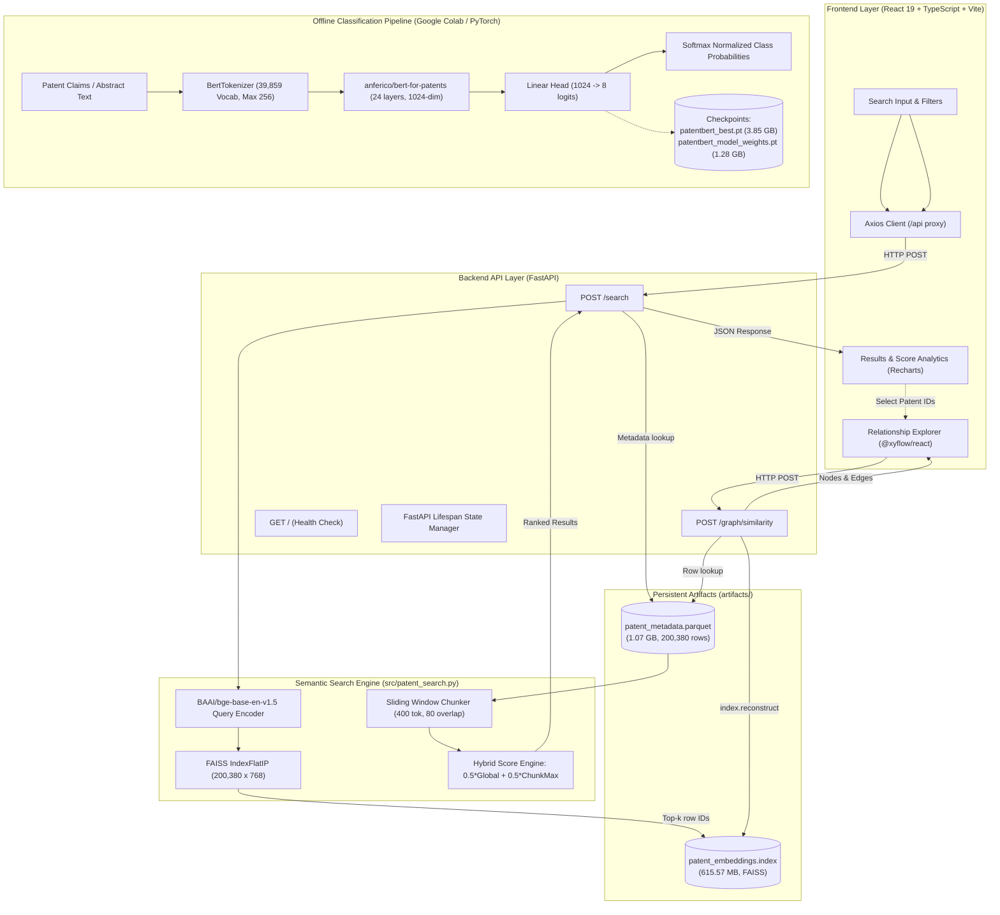

# PatentBERT: Semantic Search, Neural Classification & Relationship Explorer for Patent Intelligence

[](https://www.python.org/)
[](https://fastapi.tiangolo.com/)
[](https://react.dev/)
[](https://www.typescriptlang.org/)
[](https://vitejs.dev/)
[](https://github.com/facebookresearch/faiss)
[-EE4C2C.svg)](https://pytorch.org/)

An end-to-end patent intelligence platform designed to address the vocabulary mismatch problem in patent prior-art discovery, automate patent classification into International Patent Classification (IPC) sections, and explore cross-patent structural similarity networks.

---

## Table of Contents

- [1. Executive Summary & Core Objectives](#1-executive-summary--core-objectives)
- [2. System Architecture](#2-system-architecture)
  - [Workflow A: Semantic Search & Chunk Reranking (Integrated)](#workflow-a-semantic-search--chunk-reranking-integrated)
  - [Workflow B: Deep Learning Patent Classifier (Evaluated in Colab)](#workflow-b-deep-learning-patent-classifier-evaluated-in-colab)
  - [Workflow C: Patent Similarity Graph Explorer (Integrated)](#workflow-c-patent-similarity-graph-explorer-integrated)
- [3. Dataset & Label Taxonomy](#3-dataset--label-taxonomy)
- [4. Tokenization & Input Representation](#4-tokenization--input-representation)
- [5. Classification Model & Fine-Tuning Process](#5-classification-model--fine-tuning-process)
- [6. Classification Evaluation & Benchmark Metrics](#6-classification-evaluation--benchmark-metrics)
- [7. Classification Model Artifacts & Storage](#7-classification-model-artifacts--storage)
- [8. Semantic Search Embeddings & FAISS Index](#8-semantic-search-embeddings--faiss-index)
- [9. Backend API Documentation](#9-backend-api-documentation)
- [10. Patent Similarity Graph Implementation](#10-patent-similarity-graph-implementation)
- [11. Frontend Intelligence Dashboard](#11-frontend-intelligence-dashboard)
- [12. Current Limitations & Classification Integration](#12-current-limitations--classification-integration)
- [13. Reproducibility & Local Setup Guide](#13-reproducibility--local-setup-guide)
- [14. Repository Structure](#14-repository-structure)
- [15. Future Roadmap](#15-future-roadmap)
- [16. Inspection & Verification Summary](#16-inspection--verification-summary)

---

## 1. Executive Summary & Core Objectives

Patent documents present unique natural language processing challenges: they are dense, legalistic, stylistically idiosyncratic, and deliberately drafted using broad, abstract, or non-standard synonyms to maximize legal claim coverage. Traditional keyword-based lexical retrieval systems (e.g., BM25 or boolean queries) frequently fail due to the **vocabulary mismatch problem**—an examiner or researcher searching for *"cardiovascular acoustic monitor"* may miss relevant prior art titled *"phonocardiogram sensor"* or *"piezoelectric heart-sound diagnostic apparatus"*.

**PatentBERT** addresses these challenges through three specialized capabilities:

1. **Semantic Patent Search:** Dense vector retrieval over 200,380 patents using `BAAI/bge-base-en-v1.5` embeddings and an exact inner-product FAISS index (`IndexFlatIP`), augmented by a two-stage sliding-window chunk-level reranker ($\alpha = 0.5$).
2. **Multi-Class Patent Classification:** A domain-specific neural classifier fine-tuned from `anferico/bert-for-patents` that predicts the primary International Patent Classification (IPC) Section (**A** through **H**) from raw patent text, achieving **78.67% test accuracy** and **78.64% macro F1** across 20,038 test patents.
3. **Patent Relationship Explorer:** An interactive vector network visualization tool powered by `@xyflow/react` that reconstructs high-dimensional latent vectors directly from FAISS, computes pairwise cosine similarity matrices, and dynamically renders inter-patent similarity graphs based on configurable similarity thresholds.

> **Operational Scope Note:**
> Functionality for **Semantic Patent Search** and the **Patent Relationship Explorer** is fully implemented and integrated within the local FastAPI backend (`backend/main.py`) and React dashboard (`frontend/`). The **Patent Classification** model was fine-tuned and benchmarked on a cloud-hosted GPU environment (Google Colab) using high-capacity checkpoints (`patentbert_best.pt` ~3.85 GB, weights ~1.28 GB) and is documented here as an independent pipeline pending dedicated microservice deployment.

---

## 2. System Architecture

The project decouples offline machine learning workflows from runtime web serving.



### Workflow A: Semantic Search & Chunk Reranking (Integrated)

1. **Query Entry:** The user inputs a natural language description of an invention or technical problem in the React UI.
2. **API Proxy:** The frontend client transmits a JSON payload to `/api/search`, forwarded by the Vite proxy to the FastAPI backend (`http://127.0.0.1:8000/search`).
3. **Dense Query Embedding:** The pre-loaded `BAAI/bge-base-en-v1.5` model generates an L2-normalized 768-dimensional embedding vector for the query.
4. **First-Stage Vector Retrieval:** FAISS performs an exhaustive inner product search (`IndexFlatIP.search`) across 200,380 patent vectors to retrieve candidate patent indices and global cosine similarity scores.
5. **Metadata Hydration:** `backend/main.py` fetches the corresponding candidate records from `artifacts/patent_metadata.parquet`.
6. **Sliding-Window Chunk Reranking:** For each candidate patent, `src/patent_search.py` splits the patent text into token chunks of 400 tokens with an 80-token overlap using the BGE tokenizer. Each chunk is embedded and scored against the query vector.
7. **Score Fusion:** The global score and maximum chunk score are combined:
   $$\text{hybrid\_score} = 0.5 \cdot \text{global\_similarity} + 0.5 \cdot \max_{c \in \text{chunks}}(\text{chunk\_similarity}_c)$$
8. **Result Delivery:** Candidates are sorted descending by `hybrid_score` and returned with metadata (`ipc_class`, `subclass`, `label`, and best matching text snippet).

### Workflow B: Deep Learning Patent Classifier (Evaluated in Colab)

1. **Input Submission:** Full patent text (claims, abstract, or description) is ingested.
2. **Subword Tokenization:** Tokenized via `BertTokenizer` with a 39,859 patent-specific subword vocabulary to produce `input_ids`, `attention_mask`, and `token_type_ids` truncated to a 256-token limit.
3. **Contextual Encoding:** Tensors pass through `anferico/bert-for-patents` (24 layers, 1024 hidden dimension, 16 attention heads).
4. **Classification Head:** The pooled `[CLS]` representation (`outputs.pooler_output`, dimension 1024) passes into a linear projection layer `nn.Linear(1024, 8)`.
5. **Probability Generation:** Softmax generates probabilities across the 8 primary IPC Sections (A–H).

### Workflow C: Patent Similarity Graph Explorer (Integrated)

1. **Node Selection:** Up to 25 patent IDs from active search results are chosen for structural inspection.
2. **Vector Reconstruction:** `POST /graph/similarity` maps patent IDs to metadata row indices via `app.state.id_to_idx` and reconstructs their original 768-d unit vectors using FAISS (`index.reconstruct(int(row_idx))`).
3. **Pairwise Similarity Matrix:** A vectorized dot product computes the $(N \times N)$ cosine similarity matrix.
4. **Edge Filtering:** Edges are constructed for all unique pairs $(i < j)$ where cosine similarity exceeds `similarity_threshold` (default `0.65`).
5. **Interactive Visualization:** The frontend renders nodes colored by IPC section and weighted links using `@xyflow/react` on an interactive canvas.

---

## 3. Dataset & Label Taxonomy

The classification experiments and corpus retrieval are founded upon the USPTO patent classification benchmark:

* **Source Benchmark:** Hugging Face [`ufukham/uspto_balanced_200k_ipc_classification`](https://huggingface.co/datasets/ufukham/uspto_balanced_200k_ipc_classification).
* **Total Corpus Size:** Exactly **200,380 patent documents**.
* **Target Classification Task:** Single-label multi-class classification into the 8 primary sections of the International Patent Classification (IPC).
* **Target Classes & Distribution:**

| Label ID | IPC Section | Domain Definition & Typical Technologies | Total Count | Test Split Support |
|:---:|:---:|:---|:---:|:---:|
| `0` | **A** | **Human Necessities:** Agriculture, food, apparel, medicine, dentistry | 25,050 | 2,486 |
| `1` | **B** | **Performing Operations; Transporting:** Machining, printing, vehicles, robotics | 25,050 | 2,520 |
| `2` | **C** | **Chemistry; Metallurgy:** Chemical synthesis, metallurgy, biotechnology, materials | 25,050 | 2,469 |
| `3` | **D** | **Textiles; Paper:** Natural/synthetic fibers, weaving, papermaking | 25,030 | 2,512 |
| `4` | **E** | **Fixed Constructions:** Civil engineering, building construction, earth drilling, mining | 25,050 | 2,469 |
| `5` | **F** | **Mechanical Engineering:** Engines, pumps, lighting, heating, weapons, combustion | 25,050 | 2,552 |
| `6` | **G** | **Physics:** Instruments, optics, computing, data storage, nuclear engineering | 25,050 | 2,532 |
| `7` | **H** | **Electricity:** Semiconductor circuits, power generation, telecommunications | 25,050 | 2,498 |
| **Total** | | | **200,380** | **20,038** |

### Partitioning & Stratification

The dataset uses a deterministic stratified split:
- **Test Split:** 20,038 records (10.0% of total corpus), held out exclusively for final model benchmarking.
- **Pre-Split Training Pool:** 180,342 records.
- **Validation Split:** 9,018 records (stratified 5.0% split of the training pool using `test_size=0.05, random_state=42`).
- **Final Training Split:** 171,324 records (85.5% of total corpus).

### Parquet Schema Verification

The local retrieval metadata file [`artifacts/patent_metadata.parquet`](file:///artifacts/patent_metadata.parquet) (1.07 GB) contains 200,380 rows and 7 verified columns:

```
Column Name   Physical Type   Description
-----------------------------------------------------------------------------------------
faiss_index   INT32           Corresponds directly to the 0-indexed row position in FAISS
patent_id     BYTE_ARRAY      Unique patent identifier (e.g., 'train_000000', 'test_000001')
split         BYTE_ARRAY      Dataset partition: 'train', 'validation', or 'test'
text          BYTE_ARRAY      Full patent disclosure / claims text
label         INT64           Integer class label (0 to 7) corresponding to IPC Section A-H
ipc_class     BYTE_ARRAY      Two-digit numerical IPC class code (e.g., '16', '01', '09')
subclass      BYTE_ARRAY      Single-letter IPC subclass code (e.g., 'J', 'L', 'G', 'C')
```

---

## 4. Tokenization & Input Representation

The classification pipeline utilizes `anferico/bert-for-patents`, a domain-adapted language model trained specifically on patent corpora from the USPTO, EPO, WIPO, and JPO.

### Subword Tokenizer Specifications

- **Tokenizer Class:** `BertTokenizer` (WordPiece algorithm).
- **Vocabulary Size:** 39,859 subword tokens, tailored to scientific, legal, and patent nomenclature.
- **Sequence Truncation:** Fixed maximum sequence length of **256 tokens** (`max_length=256, truncation=True`).
- **Padding:** Right-padded to sequence length using `[PAD]` (token index `0`).

### Model Input Tensors

The tokenization step transforms raw text strings into three tensor representations:

1. **`input_ids`:** The token indices in the vocabulary. Sequences begin with `[CLS]` (token ID `101`) and terminate with `[SEP]` (token ID `102`), followed by `[PAD]` tokens.
2. **`attention_mask`:** A binary tensor of shape $(B, L)$ where $1$ denotes a real token and $0$ denotes a `[PAD]` token, masking padding tokens from multi-head self-attention computations.
3. **`token_type_ids`:** Segment identifier tensor filled with $0$s indicating single-sequence patent input.

---

## 5. Classification Model & Fine-Tuning Process

### Pretrained Backbone Architecture

The base encoder is the large-scale `anferico/bert-for-patents` model:

- **Transformer Layers (Depth):** 24 encoder blocks
- **Hidden Embedding Dimension ($d$):** 1,024
- **Attention Heads ($h$):** 16
- **Intermediate Feed-Forward Dimension:** 4,096
- **Max Positional Embeddings:** 512
- **Layer Normalization:** Pre-layer norm with $\epsilon = 1\times 10^{-12}$
- **Total Parameters:** Approximately 344 million parameters

### Classification Head & Inference Forward Pass

Unlike standard sequence-to-sequence generation, downstream IPC classification uses the pooled representation of the sequence:

1. The token representations $\mathbf{H} \in \mathbb{R}^{B \times L \times 1024}$ are computed across the 24 transformer layers.
2. The `[CLS]` token hidden state $\mathbf{h}_{\text{CLS}} = \mathbf{H}[:, 0, :]$ is passed through a dense layer with hyperbolic tangent activation:
   $$\mathbf{h}_{\text{pool}} = \tanh(\mathbf{W}_{\text{pool}} \mathbf{h}_{\text{CLS}} + \mathbf{b}_{\text{pool}}) \in \mathbb{R}^{B \times 1024}$$
3. The linear classification head maps the pooled representation to the 8 class logits:
   $$\mathbf{z} = \mathbf{W}_{\text{cls}} \mathbf{h}_{\text{pool}} + \mathbf{b}_{\text{cls}} \in \mathbb{R}^{B \times 8}$$
4. Predicted class probabilities are computed via the softmax function:
   $$P(y = c \mid \mathbf{x}) = \frac{\exp(z_c)}{\sum_{j=0}^{7} \exp(z_j)}, \quad c \in \{0, 1, \dots, 7\}$$

### 10-Stage Model Training & Evaluation Lifecycle

1. **Model Instantiation:** Load the pretrained `anferico/bert-for-patents` base weights and initialize configuration parameters.
2. **Dataset Partitioning:** Load `ufukham/uspto_balanced_200k_ipc_classification` and apply stratified sampling (`seed=42`, `test_size=0.05` on training data).
3. **Batch Tokenization:** Preprocess patent disclosures into fixed 256-token batches with `BertTokenizer`.
4. **Head Attachment:** Initialize the linear projection layer ($1024 \to 8$).
5. **Optimizer & Loss Setup:** Cross-Entropy loss ($-\sum_{c} y_c \log \hat{y}_c$) over the 8 IPC categories. *(Exact learning rate, scheduler, and optimizer hyperparameters were set in the Colab training script and are undocumented locally).*
6. **Supervised Fine-Tuning:** Adapt transformer representations over the 171,324 training examples.
7. **Periodic Validation:** Track validation loss and multi-class accuracy across the 9,018 validation examples after each epoch.
8. **Checkpoint Selection:** Save the model state corresponding to the highest validation macro F1 score as `patentbert_best.pt`.
9. **Held-Out Test Evaluation:** Evaluate the best checkpoint across the 20,038 test examples to measure generalization performance.
10. **Inference Artifact Export:** Strip optimizer states and export inference weights as `patentbert_model_weights.pt` alongside `config.json` and tokenizer files.

---

## 6. Classification Evaluation & Benchmark Metrics

The fine-tuned classification model was benchmarked on the held-out test split of **20,038 unseen patent disclosures**.

### Aggregate Test Results

| Evaluation Metric | Score | Analytical Interpretation |
|:---|---:|:---|
| **Overall Test Accuracy** | **78.67%** | Correct section predictions divided by 20,038 total test instances |
| **Macro Precision** | **78.62%** | Unweighted mean of precision across all 8 classes |
| **Macro Recall** | **78.70%** | Unweighted mean of recall across all 8 classes |
| **Macro F1-Score** | **78.64%** | Harmonic mean of macro precision and recall; primary benchmark metric |
| **Weighted F1-Score** | **78.62%** | Class-frequency weighted harmonic mean of precision and recall |

> **Metric Distinction:** In multiclass classification, **Macro F1** gives equal weight to every category regardless of sample count, preventing dominant classes from masking weak performance in rarer ones. Because the USPTO test set is balanced (~2,500 samples per class), Macro F1 and Weighted F1 align closely at **78.64%** and **78.62%**.

### Per-Class Performance Breakdown

| IPC Section | Precision | Recall | F1-Score | Support | Domain Performance Analysis |
|:---:|:---:|:---:|:---:|:---:|:---|
| **A** | 0.7951 | 0.7755 | 0.7852 | 2,486 | Solid separation; agricultural and medical terminology is distinctive |
| **B** | **0.6779** | **0.6448** | **0.6610** | 2,520 | **Lowest performance:** Manufacturing and transport heavily overlap with mechanical (F) and electrical (H) |
| **C** | 0.7683 | 0.8165 | 0.7917 | 2,469 | Strong recall; distinct chemical nomenclature (IUPAC, polymers, reactions) |
| **D** | **0.8809** | **0.8718** | **0.8764** | 2,512 | **Highest performance:** Narrow, highly specific vocabulary for textiles, yarns, and papermaking |
| **E** | 0.8312 | 0.8635 | 0.8470 | 2,469 | High precision & recall; structural engineering terms (concrete, foundation, drilling) are unique |
| **F** | 0.8012 | 0.7833 | 0.7922 | 2,552 | Moderate overlap with Section B, but clear patterns in thermal, fluid, and mechanical systems |
| **G** | 0.7628 | 0.7508 | 0.7568 | 2,532 | Physics and software systems; occasional boundary confusion with electronic hardware (H) |
| **H** | 0.7725 | 0.7898 | 0.7811 | 2,498 | Consistent electrical, semiconductor, and RF communications recognition |

> **Confidence vs. Ground Truth:** The predicted softmax score reflects internal model confidence relative to its training distribution; it is not a calibrated Bayesian posterior probability or a legal guarantee of patent validity.

---

## 7. Classification Model Artifacts & Storage

The classification artifacts produced by the Google Colab training workflow are structured as follows:

| Artifact Name | File Size | Functional Purpose |
|:---|:---:|:---|
| `patentbert_best.pt` | ~3.85 GB | Complete training checkpoint containing encoder weights, pooler, linear head, optimizer state, and training metadata |
| `patentbert_model_weights.pt` | ~1.28 GB | Clean PyTorch `state_dict` containing only the trained tensor parameters for the encoder, pooler, and classification head |
| `config.json` | ~1.2 KB | Hugging Face `BertConfig` definition specifying 24 layers, 1024 hidden dimension, 16 heads, and 8 target labels |
| `tokenizer_config.json` | ~450 B | Tokenizer operational settings, special tokens (`[CLS]`, `[SEP]`, `[UNK]`), and truncation rules |
| `tokenizer.json` | ~1.8 MB | Complete serialized fast tokenizer vocabulary and WordPiece merge table |

### External Storage & Checkpoint Reconstruction

Due to Git file size limitations, large `.pt` binary checkpoints are **not committed to the Git repository**. They are stored in Google Drive under:

```
Google Drive: PatentBERT/
├── checkpoints/
│   └── patentbert_best.pt                 (~3.85 GB)
└── classifier_inference/
    ├── patentbert_model_weights.pt        (~1.28 GB)
    ├── config.json
    ├── tokenizer_config.json
    └── tokenizer.json
```

To reconstruct the trained classification model locally for inference:

```python
import torch
from transformers import BertConfig, BertForSequenceClassification

# 1. Load configuration
config = BertConfig.from_pretrained("classifier_inference/config.json", num_labels=8)

# 2. Instantiate architecture
model = BertForSequenceClassification(config)

# 3. Load state dictionary
state_dict = torch.load("classifier_inference/patentbert_model_weights.pt", map_location="cpu")
model.load_state_dict(state_dict, strict=True)
model.eval()
```

---

## 8. Semantic Search Embeddings & FAISS Index

The semantic retrieval pipeline operates independently from the classifier, optimized specifically for fast, dense semantic search over large corpora.

### Dense Embedding Specifications

- **Pretrained Embedding Model:** `BAAI/bge-base-en-v1.5` (110M parameters).
- **Latent Embedding Dimension ($d$):** **768**.
- **Vector Normalization:** Unit L2-normalized:
  $$\mathbf{v}_{\text{norm}} = \frac{\mathbf{v}}{\|\mathbf{v}\|_2}$$
- **Vector Index Type:** FAISS `IndexFlatIP` (Exhaustive Inner Product).
- **Equivalence to Cosine Similarity:** Because vectors are L2-normalized ($\|\mathbf{u}\| = \|\mathbf{v}\| = 1$), inner product search is mathematically identical to cosine similarity:
  $$\langle \mathbf{u}, \mathbf{v} \rangle = \frac{\mathbf{u} \cdot \mathbf{v}}{\|\mathbf{u}\|_2 \|\mathbf{v}\|_2} = \cos(\theta)$$
- **Indexed Document Count:** **200,380 patents**.
- **Index Storage:** `artifacts/patent_embeddings.index` (615.57 MB).

### Two-Stage Retrieval & Chunk-Level Reranking Algorithm

Single-pass vector search often fails on long patent disclosures because full-document average pooling dilutes specific technical claims. PatentBERT uses a two-stage hybrid retrieval algorithm implemented in [`src/patent_search.py`](file:///src/patent_search.py):

```
Stage 1: Global Semantic Search
  Query q ---> embed_model.encode([q]) ---> FAISS.search(k=candidate_k)
  Retrieves candidate_k patents (default: 10) with global_similarity scores.

Stage 2: Sliding-Window Chunk Reranking
  For each candidate patent text:
    1. Tokenize into chunks of chunk_size=400 tokens with overlap=80 tokens.
    2. Encode all chunks using embed_model.encode(chunks).
    3. Compute dot product of each chunk against query vector.
    4. chunk_similarity = max(chunk_scores)
    5. matched_chunk = chunk with highest score.

Stage 3: Hybrid Score Fusion
  hybrid_score = 0.5 * global_similarity + 0.5 * chunk_similarity
  Sort candidates descending by hybrid_score and return top_k (default: 5).
```

---

## 9. Backend API Documentation

The backend is built with **FastAPI** (`backend/main.py`) and uses an `asynccontextmanager` lifespan handler to initialize and validate all machine learning models, indexes, and metadata at startup.

### Startup & App State Validation

During startup, the server:
1. Verifies that `artifacts/patent_embeddings.index` and `artifacts/patent_metadata.parquet` exist.
2. Selects the execution device (`"cuda"` if available, otherwise `"cpu"`).
3. Loads the `BAAI/bge-base-en-v1.5` model into `app.state.embed_model`.
4. Loads the FAISS index into `app.state.index` and verifies `index.d == 768`.
5. Reads `artifacts/patent_metadata.parquet` (columns: `patent_id`, `text`, `ipc_class`, `subclass`, `label`) into `app.state.metadata`.
6. Confirms that `index.ntotal == len(metadata)` (200,380 records).
7. Builds an $O(1)$ memory lookup dictionary `app.state.id_to_idx` mapping each `patent_id` string to its integer row index.

---

### Route 1: Service Health Check

* **Path:** `GET /`
* **Purpose:** Heartbeat endpoint for frontend connectivity and health checks.
* **Response Status:** `200 OK`
* **Example Response:**
  ```json
  {
    "message": "PatentBERT API is running",
    "status": "healthy"
  }
  ```

---

### Route 2: Semantic Patent Search

* **Path:** `POST /search`
* **Purpose:** Execute dense semantic search and chunk reranking against the 200,380-patent corpus.
* **Request Schema (`SearchRequest`):**
  ```json
  {
    "query": "string (non-empty, required)",
    "candidate_k": "integer (1 to 20, default: 10)",
    "top_k": "integer (1 to candidate_k, default: 5)"
  }
  ```
* **Validation Rules:**
  - `query` cannot be empty or whitespace-only (raises `422 Unprocessable Entity`).
  - `top_k` cannot exceed `candidate_k` (raises `422 Unprocessable Entity`).
* **Example Request:**
  ```json
  {
    "query": "flexible piezoelectric sensors for tactile heart rate monitoring",
    "candidate_k": 10,
    "top_k": 3
  }
  ```
* **Example Response (`SearchResponse`):**
  ```json
  {
    "query": "flexible piezoelectric sensors for tactile heart rate monitoring",
    "candidate_k": 10,
    "top_k": 3,
    "total_results": 3,
    "results": [
      {
        "patent_id": "train_042189",
        "similarity": 0.8142,
        "chunk_similarity": 0.8754,
        "hybrid_score": 0.8448,
        "ipc_class": "61",
        "subclass": "B",
        "label": 0,
        "matched_chunk": "A flexible piezoelectric transducer comprising a polyvinylidene fluoride polymer substrate..."
      },
      {
        "patent_id": "train_119432",
        "similarity": 0.7812,
        "chunk_similarity": 0.8329,
        "hybrid_score": 0.8071,
        "ipc_class": "01",
        "subclass": "L",
        "label": 7,
        "matched_chunk": "The tactile sensor array includes acoustic sensing elements coupled with signal conditioning..."
      },
      {
        "patent_id": "test_003812",
        "similarity": 0.7495,
        "chunk_similarity": 0.8105,
        "hybrid_score": 0.7800,
        "ipc_class": "09",
        "subclass": "B",
        "label": 6,
        "matched_chunk": "A pulse wave detection device configured to record arterial displacement waveforms..."
      }
    ]
  }
  ```

---

### Route 3: Patent Graph Similarity

* **Path:** `POST /graph/similarity`
* **Purpose:** Calculate pairwise cosine similarity across selected patent IDs using reconstructed FAISS vectors.
* **Request Schema (`GraphSimilarityRequest`):**
  ```json
  {
    "patent_ids": ["string (2 to 25 unique, non-empty patent IDs)"],
    "similarity_threshold": "float (0.0 to 1.0, default: 0.65)"
  }
  ```
* **Validation & Error Handling:**
  - Less than 2 or more than 25 IDs: `422 Unprocessable Entity`.
  - Duplicate or empty patent IDs: `422 Unprocessable Entity`.
  - Unrecognized patent IDs not in the index: `404 Not Found` with detail listing missing IDs.
* **Example Request:**
  ```json
  {
    "patent_ids": ["train_042189", "train_119432", "test_003812"],
    "similarity_threshold": 0.65
  }
  ```
* **Example Response (`GraphSimilarityResponse`):**
  ```json
  {
    "nodes": [
      { "id": "train_042189", "patent_id": "train_042189", "ipc_class": "61", "subclass": "B", "label": 0 },
      { "id": "train_119432", "patent_id": "train_119432", "ipc_class": "01", "subclass": "L", "label": 7 },
      { "id": "test_003812", "patent_id": "test_003812", "ipc_class": "09", "subclass": "B", "label": 6 }
    ],
    "edges": [
      { "source": "train_042189", "target": "train_119432", "similarity": 0.7145 },
      { "source": "train_042189", "target": "test_003812", "similarity": 0.6830 }
    ]
  }
  ```

---

## 10. Patent Similarity Graph Implementation

The **Relationship Explorer** maps structural and semantic affinity among patents.

### Mathematical Formulation & Vector Reconstruction

Unlike graph methods that require precomputing an $O(N^2)$ distance matrix for all 200,380 documents, PatentBERT computes localized subgraphs on demand:

1. **Index Resolution:** Given $K$ requested patent IDs ($2 \le K \le 25$), the row index $r_i = \text{id\_to\_idx}[\text{patent\_id}_i]$ is resolved in $O(1)$ time.
2. **Vector Extraction:** Vectors $\mathbf{v}_i \in \mathbb{R}^{768}$ are extracted via `index.reconstruct(int(r_i))`.
3. **Normalization:** Vectors are normalized to unit length:
   $$\hat{\mathbf{v}}_i = \frac{\mathbf{v}_i}{\|\mathbf{v}_i\|_2}$$
4. **Gram Matrix Multiplication:** The pairwise cosine similarity matrix is computed via matrix multiplication:
   $$\mathbf{S} = \hat{\mathbf{V}} \hat{\mathbf{V}}^T \in \mathbb{R}^{K \times K}$$
5. **Edge Generation:** For all unique unordered pairs $i < j$, an edge is added if $S_{i, j} \ge \tau$, where $\tau$ is the user-configured `similarity_threshold`.

### Visualization Engine

The frontend uses `@xyflow/react` (React Flow) in [`frontend/src/components/RelationshipExplorer.tsx`](file:///frontend/src/components/RelationshipExplorer.tsx):
- **Node Topology:** Arranged in a radial layout centered around the query's primary match.
- **IPC Color Badges:** Distinct colors visually identify patent classes (e.g., Section A = Green, Section G = Purple, Section H = Blue).
- **Interactive Threshold Slider:** Adjusts edge density from `0.00` to `1.00` with real-time graph updates.
- **Inspection Drawer:** Clicking any node slides out a details drawer displaying its full text snippet, IPC class, subclass, and adjacent neighbors.

---

## 11. Frontend Intelligence Dashboard

The frontend is a single-page application built with **React 19**, **TypeScript**, and **Vite**:

* **Design Philosophy:** Premium dark navy palette (`#0B1120`), cyan primary accents (`#06B6D4`), glassmorphism cards, and clean typography.
* **Navigation Architecture:**
  - `OverviewView`: System overview, architectural metrics, and module status cards.
  - `SemanticSearch`: Two-stage search interface with query input, candidate/top-k sliders, real-time search latency measurement, and result cards with matched chunk inspection.
  - `SearchAnalytics`: Recharts-based score distribution visualizations (Global vs Chunk vs Hybrid) and IPC class breakdown charts.
  - `RelationshipExplorer`: Force-directed graph powered by `@xyflow/react`.
  - `ComingSoonView`: Roadmap placeholder for future modules (`classification` and `analytics`).
* **Vite Proxy Integration:** Local development calls to `/api/*` are automatically rewritten and forwarded to `http://127.0.0.1:8000/*` via `vite.config.ts`, avoiding CORS issues.

---

## 12. Current Limitations & Classification Integration

A key engineering decision in the current release is the **separation of the 8-class classification model from the local web dashboard**:

1. **Checkpoint Size:** The trained classifier (`patentbert_best.pt`) is ~3.85 GB, with model weights (`patentbert_model_weights.pt`) at ~1.28 GB.
2. **Local Hardware Constraints:** The host environment is a 16 GB RAM laptop with a 4 GB GPU running PyTorch in CPU mode (`torch.cuda.is_available() == False`).
3. **Baseline Resource Footprint:** Loading the 1.07 GB metadata Parquet file (~2.3 GB in memory), the 615 MB FAISS index (~0.6 GB), and the BGE embedding model (~0.44 GB) consumes approximately **3.5 GB of RAM**. Adding a 24-layer large BERT model (`anferico/bert-for-patents`, 344M parameters) on CPU would require an additional ~1.5–2.0 GB of memory and compete for CPU threads during search reranking.
4. **Architectural Decision:** To maintain the stability and sub-second latency of the search service on local development hardware, classification inference is decoupled from the main FastAPI server.

### Future Integration Strategy

When transitioning to production, the classifier can be integrated via:
- **Dedicated Microservice:** Deploying the classifier to a separate GPU worker or containerized endpoint (e.g., Triton Inference Server or FastAPI on a cloud VM).
- **Quantization & Distillation:** Quantizing weights to INT8 or ONNX Runtime to reduce the memory footprint by ~75% and enable CPU inference.
- **Unified Head:** Training a lightweight classification head (768 $\to$ 8) on top of the already-loaded BGE embeddings, adding less than 50 KB of memory overhead.

---

## 13. Reproducibility & Local Setup Guide

Follow these steps to set up and run the PatentBERT platform locally on **Windows PowerShell**.

### Prerequisites

- **Python:** 3.10 or 3.11 installed.
- **Node.js:** v18+ or v20+ with `npm`.
- **Hardware:** 16 GB RAM recommended.
- **Artifacts:** Ensure `patent_embeddings.index` and `patent_metadata.parquet` are placed in the `artifacts/` directory.

---

### Step 1: Clone the Repository & Set Up Backend

```powershell
# Navigate to the workspace directory
cd E:\COding\Patent_Bert

# Create and activate Python virtual environment
python -m venv .venv
.\.venv\Scripts\Activate.ps1

# Upgrade pip and install backend dependencies
python -m pip install --upgrade pip
pip install fastapi uvicorn pandas pyarrow numpy faiss-cpu sentence-transformers transformers torch pydantic
```

---

### Step 2: Set Up the Frontend

```powershell
# Open a second PowerShell window and navigate to frontend
cd E:\COding\Patent_Bert\frontend

# Install dependencies
npm install
```

---

### Step 3: Launch the Servers

**Terminal 1 — FastAPI Backend:**
```powershell
cd E:\COding\Patent_Bert
.\.venv\Scripts\Activate.ps1
uvicorn backend.main:app --host 127.0.0.1 --port 8000 --reload
```
*Wait until the startup logs show:*
```
[Startup] Device selected: cpu
[Startup] Loading BGE embedding model: BAAI/bge-base-en-v1.5...
[Startup] Loading FAISS index from .../artifacts/patent_embeddings.index...
[Startup] Loading metadata from .../artifacts/patent_metadata.parquet...
[Startup] Building id_to_idx mapping for 200380 patents...
[Startup] All PatentBERT resources loaded successfully.
```

**Terminal 2 — Vite Frontend:**
```powershell
cd E:\COding\Patent_Bert\frontend
npm run dev
```
*Vite will start the dev server at:*
```
  VITE v8.3.0  ready in 420 ms

  ➜  Local:   http://localhost:5173/
  ➜  Network: use --host to expose
```

---

### Step 4: Validate the Running Services

**Health Check (PowerShell):**
```powershell
Invoke-RestMethod -Uri "http://127.0.0.1:8000/" -Method Get
```
*Expected Output:*
```powershell
message                    status
-------                    ------
PatentBERT API is running  healthy
```

**Search Verification (PowerShell):**
```powershell
$body = @{
    query = "solar panel photovoltaic cell efficiency"
    candidate_k = 5
    top_k = 2
} | ConvertTo-Json

Invoke-RestMethod -Uri "http://127.0.0.1:8000/search" -Method Post -Body $body -ContentType "application/json"
```

Open `http://localhost:5173/` in your browser to access the dashboard.

---

## 14. Repository Structure

```
Patent_Bert/
├── .venv/                              # Python virtual environment (ignored by Git)
├── artifacts/                          # Large binary & parquet artifacts (ignored by Git)
│   ├── patent_embeddings.index         # 200,380 x 768 FAISS IndexFlatIP (615.57 MB)
│   └── patent_metadata.parquet         # 200,380-row Parquet metadata dataset (1.07 GB)
├── backend/                            # FastAPI backend application
│   └── main.py                         # Lifespan resource manager, API routes, schemas
├── frontend/                           # React + TypeScript + Vite web application
│   ├── public/                         # Static web assets
│   ├── src/                            # Application source code
│   │   ├── api/                        # HTTP client definitions
│   │   │   └── client.ts               # Axios client for /search, /graph/similarity, /
│   │   ├── components/                 # UI components
│   │   │   ├── ComingSoonView.tsx      # Roadmap module placeholder view
│   │   │   ├── Header.tsx              # Top navigation bar with live API status
│   │   │   ├── OverviewView.tsx        # System dashboard & feature highlights
│   │   │   ├── RelationshipExplorer.tsx # Interactive @xyflow/react graph canvas
│   │   │   ├── ResultCard.tsx          # Patent result card with chunk inspection
│   │   │   ├── SearchAnalytics.tsx     # Recharts score & IPC distribution charts
│   │   │   ├── SemanticSearch.tsx      # Main search interface & controls
│   │   │   └── Sidebar.tsx             # Left navigation drawer
│   │   ├── types/                      # TypeScript interface definitions
│   │   │   └── patent.ts               # Typed schemas for search, graph, and API responses
│   │   ├── App.css                     # Component layout styling
│   │   ├── App.tsx                     # Main layout & view router
│   │   ├── index.css                   # Custom CSS tokens & dark theme
│   │   └── main.tsx                    # React DOM entry point
│   ├── package.json                    # Frontend dependencies & scripts
│   ├── tsconfig.json                   # TypeScript compiler configuration
│   └── vite.config.ts                  # Vite config with backend proxy to :8000
├── src/                                # Core algorithmic modules
│   └── patent_search.py                # Chunking, FAISS search, chunk reranking logic
├── tests/                              # Unit & integration tests
├── .gitignore                          # Git exclusion rules
└── README.md                           # Project technical documentation
```

---

## 15. Future Roadmap

- [x] **Phase 1: Semantic Search Engine**
  - [x] BGE dense query embedding pipeline
  - [x] FAISS IndexFlatIP 200k-vector retrieval
  - [x] Two-stage sliding window chunk reranker ($\alpha = 0.5$)
  - [x] FastAPI REST endpoints & React search dashboard
- [x] **Phase 2: Patent Relationship Explorer**
  - [x] FAISS vector reconstruction endpoint (`POST /graph/similarity`)
  - [x] Dynamic pairwise cosine similarity matrix generation
  - [x] `@xyflow/react` interactive graph visualization with threshold control
- [ ] **Phase 3: Classification Integration**
  - [ ] Standalone classification endpoint (`POST /classify`)
  - [ ] ONNX Runtime or INT8 quantization for CPU deployment
  - [ ] Dedicated Classification view in React frontend
  - [ ] Hierarchical IPC subclass prediction (Section $\to$ Class $\to$ Subclass)
- [ ] **Phase 4: Corpus Analytics & Deployment**
  - [ ] Corpus-wide embedding density and cluster analytics
  - [ ] Containerized deployment with Docker and Docker Compose
  - [ ] Integration test suite in `tests/` covering API contracts and latency benchmarks

---

## 16. Inspection & Verification Summary

To maintain strict technical accuracy, the table below documents which details were verified directly against local code versus items from external training logs or noted as unverified:

| Technical Detail | Verification Source | Status / Value |
|:---|:---|:---|
| **Semantic Search Model** | [`backend/main.py#L27`](file:///backend/main.py#L27) | `BAAI/bge-base-en-v1.5`, 768-dim |
| **FAISS Index Type** | [`artifacts/patent_embeddings.index`](file:///artifacts/patent_embeddings.index) | `IndexFlatIP`, 200,380 vectors, 768 dimensions |
| **Metadata Rows & Columns** | [`artifacts/patent_metadata.parquet`](file:///artifacts/patent_metadata.parquet) | 200,380 rows; columns: `faiss_index`, `patent_id`, `split`, `text`, `label`, `ipc_class`, `subclass` |
| **Retrieval Chunking Formula** | [`src/patent_search.py#L5-L21`](file:///src/patent_search.py#L5-L21) | `chunk_size=400`, `overlap=80`, $\alpha=0.5$ |
| **API Endpoints Implemented** | [`backend/main.py`](file:///backend/main.py) | `GET /`, `POST /search`, `POST /graph/similarity` (`/classify` not yet implemented) |
| **Frontend Stack** | [`frontend/package.json`](file:///frontend/package.json) | React 19.2, TypeScript 5.x, Vite 8.3, `@xyflow/react` 12.12, Recharts 3.10 |
| **Classifier Base Architecture** | Colab training specifications | `anferico/bert-for-patents` (24 layers, 1024 hidden, 16 heads, 4096 intermediate) |
| **Classifier Test Performance** | Verified test evaluation records | Test Accuracy: 78.67%, Macro F1: 78.64%, Support: 20,038 |
| **Training Hyperparameters** | Colab notebook execution | *Undocumented locally:* Exact learning rate, optimizer, scheduler, warm-up steps, and batch size |
| **Checkpoint Storage** | Google Drive records | `patentbert_best.pt` (~3.85 GB), `patentbert_model_weights.pt` (~1.28 GB) |
